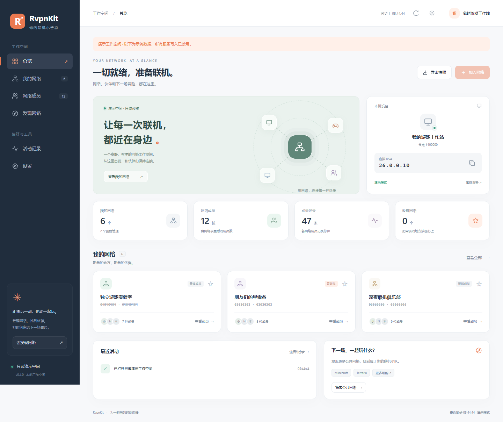

# RvpnKit

**一个轻巧、顺眼的 Radmin VPN 第三方客户端。**

管理联机网络、找到伙伴，把时间留给下一场冒险。



[查看原生 GUI 截图](docs/screenshots/gui-overview.png) · [使用文档](docs/README.md) · [更新记录](docs/CHANGELOG.md)

## 现在有什么

| 功能 | 本地 WebUI | 原生 GUI |
| --- | --- | --- |
| 总览、设备信息与真实快照统计 | ✓ | ✓ |
| 加入 / 创建网络，可填写密码 | ✓ | ✓ |
| 网络收藏、本地保存、名称 / GUID 搜索 | ✓ | ✓ |
| 成员筛选、跨网络切换与 CSV 导出 | ✓ | ✓ |
| 成员属性与批量管理请求 | ✓ | ✓ |
| 公共网络搜索 | ✓ | ✓ |
| 活动记录、快照 JSON 导出 | ✓ | ✓ |
| 浅色 / 深色、刷新间隔、紧凑列表 | ✓ | ✓ |
| 成员分页、按角色筛选、名称 / ID 排序 | ✓ | — |
| 通过 HTTP agent 访问其他机器 | ✓ | — |
| 无 Radmin 服务的只读演示 | ✓ | ✓ |

两个界面使用同一个 Rust 协议内核。WebUI 无 CDN、无 npm 构建步骤；HTML、CSS、JS 都嵌在可执行文件中。

> 这些界面控制已有的 Radmin VPN 服务，**不包含 VPN 驱动**。实际联机需要先安装并运行官方 Radmin VPN 服务。

## 运行

源码构建需要 Rust stable。Windows 推荐 MSVC 工具链；已有 GNU 工具链的环境见 [构建说明](docs/WINDOWS_GNU_TOOLCHAIN.md)。

```powershell
# 在仓库根目录运行
.\dev.ps1 build
.\dev.ps1 gui          # 原生窗口
.\dev.ps1 web          # 打开本地浏览器
```

或者直接用 Cargo：

```powershell
cd rust
cargo build --workspace --release --locked
.\target\release\rvpnkit-gui.exe
.\target\release\rvpnkit.exe
```

默认 WebUI 地址是 `http://127.0.0.1:8788`。未连接到服务时，界面仍能打开，启动服务后刷新即可。

### 先看看界面

没有安装 Radmin VPN 也可以预览；演示数据有明确标识，**不会向真实服务发送命令**。

```powershell
.\dev.ps1 demo-web
.\dev.ps1 demo-gui
# 或者
rvpnkit.exe --demo --no-open
rvpnkit-gui.exe --demo --page=members
```

### HTTP agent

跨机器访问通过保留的 .NET agent 完成：

```powershell
# 提供服务的 Windows 机器；.NET 10
dotnet run --project src/RvpnKit.Agent -- --host 127.0.0.1 --port 8770 --token YOUR_TOKEN

# Rust Web 客户端所在机器
$env:RVPNKIT_TOKEN = 'YOUR_TOKEN'
rvpnkit.exe --agent http://127.0.0.1:8770
```

Agent 默认启用鉴权。令牌只由 Rust 后端发送，不写入浏览器页面。当前客户端仅支持明文 HTTP，请在本机、可信局域网或已有的安全隧道内使用。WebUI 默认仅监听回环地址；`--addr` 可修改地址，但不提供面向公网的登录系统。

## 几个实用细节

- **收藏**：网络卡片右上角的星标；GUI 中可在总览点击星标，或在网络右键菜单收藏。
- **成员**：切换网络时自动清空选择；刷新按 GUID 保留网络，避免排序变化导致选错对象。
- **导出**：CSV 支持中文、转义和公式注入防护；JSON 不包含可逆的密码令牌。文件仍包含成员地址，请妥善保管。
- **活动**：仅记录当前会话中的服务读取、变化、请求和错误；不伪装成服务端审计日志。
- **键盘**：WebUI 中 `R` 刷新、`/` 聚焦当前页搜索、`Esc` 关闭弹窗；输入文字时不会触发快捷键。
- **操作反馈**：写操作显示服务确认的请求编号。网络最终状态以服务返回的快照为准，不虚构成功结果。

## 数据边界

控制面快照提供网络、成员别名、节点 ID、公网 IP、本机与对端虚拟 IP，以及服务可返回的在线状态、角色、延迟、通道和版本。字段缺失时界面显示“未知”，不会用虚假的绿点或数值代替。总览图形是结构示意。

## 项目结构

```text
rust/                         当前主线
  crates/rvpn-core/           协议、命名管道、快照、脱敏导出与演示数据
  crates/rvpn-web/            HTTP 服务与静态 WebUI（分离的 HTML / CSS / JS）
  crates/rvpn-gui/            egui 窗口、工作空间页面、主题、设置、传输
src/                          保留的 .NET agent、旧 GUI 和命令行工具
native/                       早期协议研究脚本；不是运行时依赖
scripts/                      本地验证工具
docs/                        使用说明与协议研究记录
```

主入口是 `dev.ps1` 和 `rust/`。早期 C# 说明保留于 [历史文档](docs/legacy/README_0.2.md)，协议研究见 [PROTOCOL.md](docs/PROTOCOL.md)。

## 验证与打包

```powershell
.\dev.ps1 test
.\dev.ps1 package
# 或者在 rust/ 内
cargo test --workspace --release --locked
cargo fmt --all -- --check
```

WebUI 的浏览器回归脚本见 `scripts/web-smoke.cjs`；需要本地安装 Playwright 和 Chrome / Edge。它使用只读演示服务与本地模拟响应，验证导航、收藏、筛选、分页、导出和错误恢复，不操作真实 VPN。

发布脚本从当前 Cargo 输出目录取文件，不依赖开发者机器上的 `C:\rtools` 路径，不覆盖已有同名发布目录。

## 项目说明

这是非官方的互操作工具，与 Famatech / Radmin VPN 无隶属关系。协议实现来自研究，仅在你有权管理的网络中使用；官方协议变更可能影响兼容性。原有研究与工具保留，避免丢失可追溯信息。
