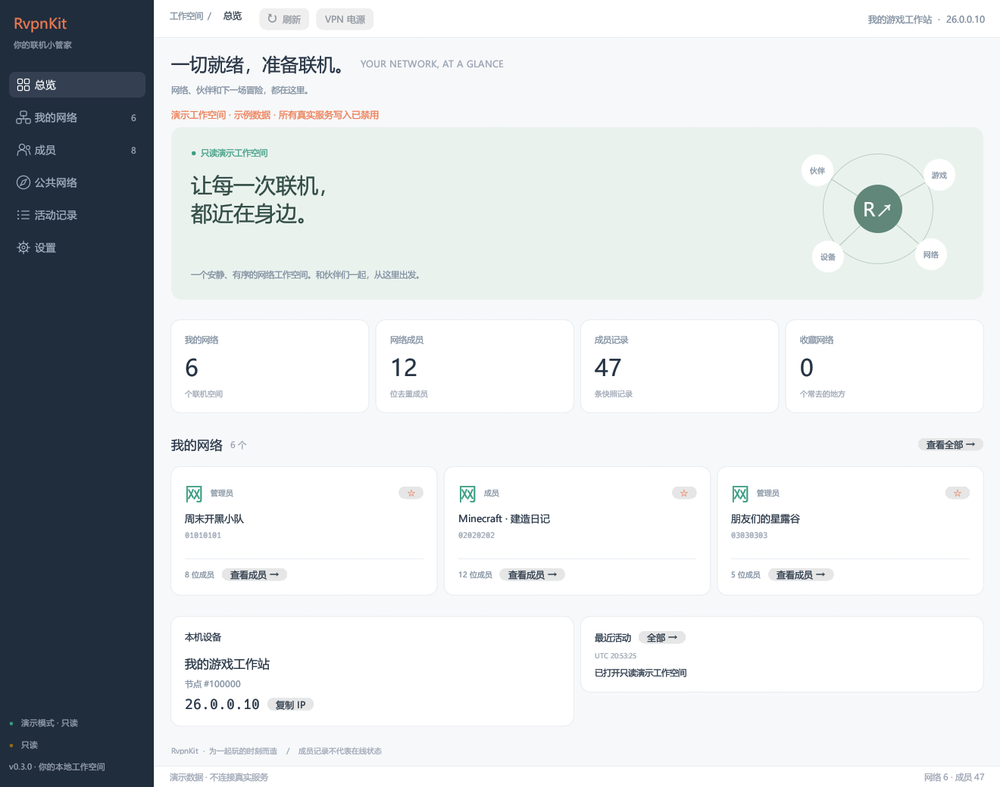

# RvpnKit 原生 GUI

当前主线是 `rust/crates/rvpn-gui`，使用 egui。旧 Avalonia GUI 保留于 `src/RvpnKit.App`，相关旧说明见 [历史文档](legacy/AVALONIA_GUI.md)。



## 运行

```powershell
# 仓库根目录
.\dev.ps1 gui
.\dev.ps1 demo-gui
```

也可以直接打开发布目录中的 `rvpnkit-gui.exe`。实际管理需要本机 Radmin VPN 服务；`--demo` 只展示示例数据，不连接真实服务。

## 页面

- **总览**：本机设备、虚拟 IP、网络和成员记录统计、常用网络、最近活动。
- **我的网络**：按名称或 GUID 搜索，收藏筛选，密码加入 / 创建；右键可查看成员、复制信息、启用 / 禁用、离开 / 删除。
- **成员**：网络下拉切换、别名 / 节点 ID / 虚拟地址 / 状态筛选、虚拟 IPv4/IPv6、角色、通道、延迟和版本、当前筛选结果 CSV 导出、成员属性、批量管理请求。
- **公共网络**：从服务获取可加入的网络，搜索名称后加入。
- **活动记录**：本次会话的服务变化、命令请求与错误；最多 100 条，可导出文本，时间为 UTC。
- **设置**：浅色 / 深色、自动刷新间隔、紧凑列表、设备别名、快照导出与导出目录。

管理命令在确认窗口中展示目标，再发送给服务。发送成功只表示请求发出；界面随后重读快照，不推测服务端结果。批量请求顺序发送，失败停止，并显示已发送数量。

收藏、主题和刷新偏好保存在用户配置目录 `RvpnKit/preferences.json`。首次启动可迁移旧版 `ui.conf` 的主题偏好。导出的 JSON 不包含协议令牌，CSV 会转义单元格并防护公式注入。

## 截图验收

```powershell
rvpnkit-gui.exe --screenshot-dir .\screenshots
```

此参数**强制使用只读演示数据**，自动截取六个页面和深色总览，然后退出。截图来自真实 egui 渲染器，不需要窗口自动化工具。正常启动不会自动截图。

## 已知边界

- 原生 GUI 当前直连 Windows 命名管道；HTTP agent 模式请使用 WebUI。
- 成员虚拟 IP、在线状态、通道类型和延迟暂不提供。列表中的成员不等于在线成员。
- 界面不安装驱动，不替代 Radmin VPN 服务。
